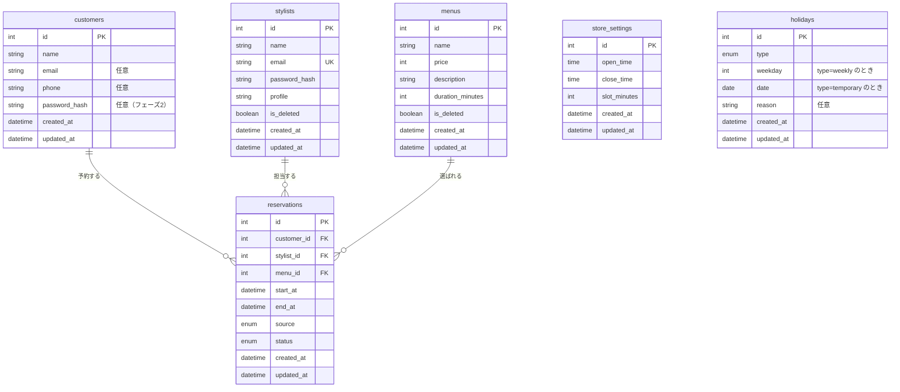

# テーブル設計

## ER 図

## テーブル定義

### customers（お客さん）

| 項目名 | 型 | 必須 | 内容 |
| --- | --- | --- | --- |
| id | 整数 | ○ | 主キー |
| name | 文字列 | ○ | 氏名 |
| email | 文字列 | | メールアドレス（ネット予約で入力） |
| phone | 文字列 | | 電話番号（電話予約で入力） |
| password_hash | 文字列 | | ハッシュ化したパスワード（フェーズ2のログイン用） |
| created_at | 日時 | ○ | 登録日時 |
| updated_at | 日時 | ○ | 更新日時 |

- email と phone は、どちらか1つを必ず入力する
- 電話番号は先頭の0が消えないように文字列で持つ

### stylists（美容師）

| 項目名 | 型 | 必須 | 内容 |
| --- | --- | --- | --- |
| id | 整数 | ○ | 主キー |
| name | 文字列 | ○ | 氏名 |
| email | 文字列 | ○ | ログイン用のメールアドレス（ユニーク） |
| password_hash | 文字列 | ○ | ハッシュ化したパスワード |
| profile | 文字列 | | 経験や得意なスタイルなどの紹介文 |
| is_deleted | 真偽値 | ○ | 論理削除 |
| created_at | 日時 | ○ | 登録日時 |
| updated_at | 日時 | ○ | 更新日時 |

### menus（メニュー）

| 項目名 | 型 | 必須 | 内容 |
| --- | --- | --- | --- |
| id | 整数 | ○ | 主キー |
| name | 文字列 | ○ | メニュー名 |
| price | 整数 | ○ | 料金（円） |
| description | 文字列 | | 概要説明 |
| duration_minutes | 整数 | ○ | 所要時間（分） |
| is_deleted | 真偽値 | ○ | 論理削除 |
| created_at | 日時 | ○ | 登録日時 |
| updated_at | 日時 | ○ | 更新日時 |

### reservations（予約）

| 項目名 | 型 | 必須 | 内容 |
| --- | --- | --- | --- |
| id | 整数 | ○ | 主キー |
| customer_id | 整数 | ○ | customers への外部キー |
| stylist_id | 整数 | ○ | stylists への外部キー |
| menu_id | 整数 | ○ | menus への外部キー |
| start_at | 日時 | ○ | 開始日時 |
| end_at | 日時 | ○ | 終了日時（予約時のメニューの所要時間から計算して保存） |
| source | 選択肢 | ○ | 予約経路 |
| status | 選択肢 | ○ | 予約の状態 |
| created_at | 日時 | ○ | 作成日時 |
| updated_at | 日時 | ○ | 更新日時 |

**source（予約経路）の選択肢**

| 値 | 意味 |
| --- | --- |
| web | ネット予約 |
| phone | 電話 |
| line | LINE |
| instagram | Instagram |
| other | その他 |

**status（予約の状態）の選択肢**

| 値 | 意味 |
| --- | --- |
| reserved | 予約済み |
| visited | 来店済み |
| canceled | キャンセル |
| no_show | 無断キャンセル |

### store_settings（基本設定）

お店に1つだけある設定値を持つ。行は1行だけ。

| 項目名 | 型 | 必須 | 内容 |
| --- | --- | --- | --- |
| id | 整数 | ○ | 主キー |
| open_time | 時刻 | ○ | 営業開始時間（例：10:00） |
| close_time | 時刻 | ○ | 営業終了時間（例：18:00） |
| slot_minutes | 整数 | ○ | 予約の時間の刻み（分。例：30） |
| created_at | 日時 | ○ | 登録日時 |
| updated_at | 日時 | ○ | 更新日時 |

### holidays（休業日）

毎週の定休日と臨時休業を、1つのテーブルで管理する。

| 項目名 | 型 | 必須 | 内容 |
| --- | --- | --- | --- |
| id | 整数 | ○ | 主キー |
| type | 選択肢 | ○ | weekly（毎週の定休日）か temporary（臨時休業） |
| weekday | 整数 | | 曜日（0=日曜〜6=土曜）。type が weekly のときだけ入れる |
| date | 日付 | | 日付。type が temporary のときだけ入れる |
| reason | 文字列 | | 理由（年末年始など） |
| created_at | 日時 | ○ | 登録日時 |
| updated_at | 日時 | ○ | 更新日時 |

- type が weekly なら weekday が必須で date は空、temporary なら date が必須で weekday は空にする

## 設計で決めたこと

- メニューと美容師は、過去の予約を残すために論理削除にする
- 予約の終了日時は保存しておく。あとでメニューの所要時間が変わっても、過去の予約の時間がずれないようにするため
- 予約経路と状態は、書き方がバラバラにならないように選択肢にする
- 同じ美容師で、status が reserved の予約同士は、時間帯が重ならないようにする
- 営業時間と予約の刻みは、お店に1つだけの値なので store_settings にまとめる
- 休業日は1つのテーブルにまとめる。今の仕様では休みの種類が「曜日で決まる定休日」と「日付で決まる臨時休業」の2つだけで、空き時間を計算するときに休みを1か所から取り出せ、設定画面でも一覧で管理しやすいため。そのかわり、type に応じて weekday と date のどちらかだけを入れるルールを守る
- 美容師個人の休みは今回は対象外（今後の検討）
