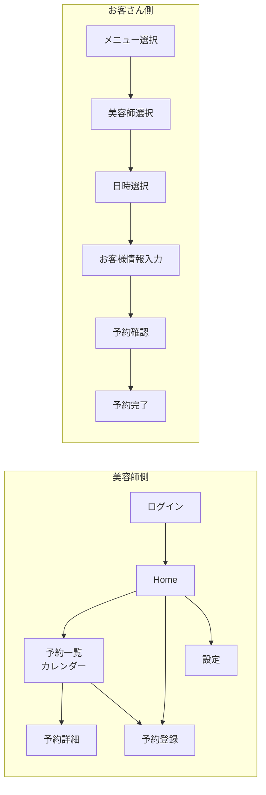

# 画面一覧

## 美容師側（フェーズ1）

| No.  | 画面      | 内容                          |
| ---- | ------- | --------------------------- |
| S-01 | ログイン画面  | 美容師がログインする                  |
| S-02 | Home 画面 | 本日の予約件数と予約一覧を表示する           |
| S-03 | 予約一覧画面  | 全予約をカレンダーで表示する              |
| S-04 | 予約詳細画面  | 選んだ予約の詳細を表示する               |
| S-05 | 予約登録画面  | 電話、LINE、SNS などで受けた予約を入力する   |
| S-06 | 設定画面    | 営業時間、予約の時間の刻み、定休日、臨時休業を設定する |

## お客さん側（フェーズ1）

| No.  | 画面        | 内容                            |
| ---- | --------- | ----------------------------- |
| C-01 | メニュー選択画面  | 受けたいメニューを選ぶ                   |
| C-02 | 美容師選択画面   | 指名する美容師を選ぶ                    |
| C-03 | 日時選択画面    | 空いている日時を選ぶ（埋まっている時間はグレーで選べない） |
| C-04 | お客様情報入力画面 | 名前とメールアドレスを入力する               |
| C-05 | 予約確認画面    | 入力内容を確認して、予約を確定する             |
| C-06 | 予約完了画面    | 「予約が完了しました」と表示する              |

## 画面の流れ

## お客さん側の選ぶ順番の理由

1. **メニューが先**：メニューによって所要時間が変わるため、空き時間の計算に必要
2. **美容師が次**：予約枠は美容師ごとなので、美容師が決まらないと空き時間がわからない
3. **日時はそのあと**：メニューと美容師が決まって、初めて正しい空き時間を表示できる

S-01  
入力項目：メールアドレス、パスワード  
パスワードの表示：初期は⚫️で隠す。「パスワードを表示」にチェックすると見える  
ボタン：ログインボタン。　  
空のまま押した時：「項目が空です。入力してください」を表示  
成功した時：Home画面へ遷移  
失敗時：「メールアドレスまたはパスワードが違います」と通知する  
ログインしていない人：美容師用の画面を開こうとしたら、ログイン画面に移動させる

|     |     |
| --- | --- |
|     |     |

